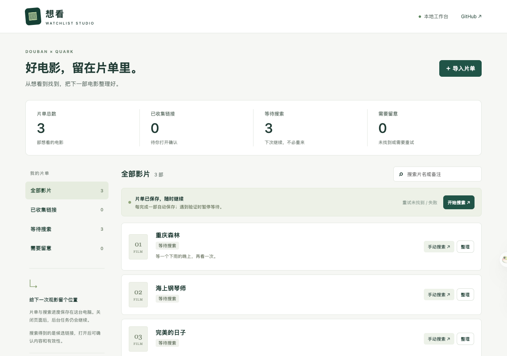

# Want to Watch · Douban and Quark Workbench

[简体中文](./README.md) · [GitHub repository](https://github.com/holynova/douban-quark-clawer)

Keep your watchlist, candidate Quark links, and notes in one local web app. The original Python command line is still available.



## Run locally

Install Python 3.10 or later. Automated search also requires Google Chrome and access to Google. Selenium may download a matching driver on first use.

```bash
python3 -m venv .venv
source .venv/bin/activate  # Windows: .venv\Scripts\activate
pip install -r requirements.txt
python server.py
```

Open [the local workbench](http://127.0.0.1:8765). On macOS you can also double-click `start.command`. The Python service keeps processing when you close the tab. Stop the server to stop the background task. Your watchlist is saved in `output/library.json`.

Use `python server.py --port 8766 --data-dir /path/to/my-watchlist` for a separate local instance or data directory.

## Import, search, and export

- Import a public Douban watchlist URL, one title per line, or an existing JSON file. Douban imports save each successful page and offer limits of 50, 300, or 1,000 titles.
- Start searching in a dedicated Chrome window. Progress saves after each title. You can pause or restart and continue from the remaining entries. When Google requests a verification, the queue pauses and retains the browser for manual action.
- Filter by title, notes, or status. Review candidate links before use and edit the links and notes in the workbench. Search collects candidate links. The workbench has no automatic transfer to Quark.
- Export JSON to re-import into the workbench, or CSV to open in a spreadsheet.

Old title arrays and Quark-link exports can be imported, as can the version 2 JSON format. Imports preserve existing links and notes and use the Douban item URL to distinguish titles where available. If a Douban page requires login or verification, entries saved from earlier pages remain accessible.

## CLI and checks

```bash
python main.py https://movie.douban.com/people/YOUR_ID/wish
python -m unittest discover -s tests -v
```

The command line saves `output/wishlist.json` and `output/quark_links.json`. See the [Chinese README](./README.md) for the status legend, layout, and storage details.
