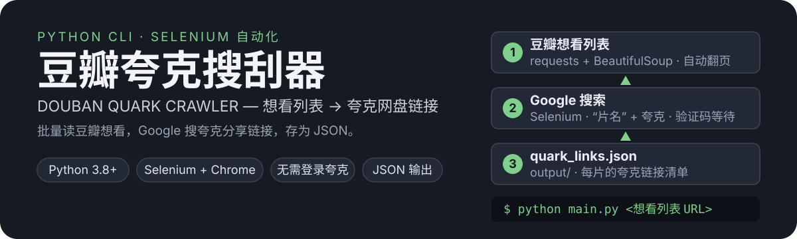

<p align="right"><a href="README.en.md">English</a></p>

<p align="center">
  
</p>

<p align="center">
  <a href="https://douban-quark-clawer.xiaosang.cc/">▶ 项目主页</a>
  ·
  <a href="https://github.com/holynova/douban-quark-clawer">GitHub 仓库</a>
</p>

全自动化的 Python 命令行工具：批量读取你的豆瓣"想看"列表，逐片在 Google 上搜索夸克网盘分享链接，把结果存为 JSON。主流程只做搜索与导出，不登录夸克网盘。

## 工作流程

1. **抓想看列表** — `requests` + BeautifulSoup 抓取指定豆瓣用户的"想看"列表，自动翻页，存为 `output/wishlist.json`。
2. **逐片搜链接** — Selenium 驱动 Chrome，在 Google 搜索 `"片名" 夸克`，用正则从结果页提取 `pan.quark.cn/s/...` 分享链接；片与片之间停 2 秒，每 10 片存一次中间结果。
3. **导出 JSON** — 汇总存为 `output/quark_links.json`，每条是 `{title, quark_links}`；中途按 Ctrl+C 或出错时也会保存已搜到的进度。

## 使用方法

环境要求：Python 3.8+、Google Chrome（能访问 Google 的网络）。

```bash
pip install -r requirements.txt
python main.py https://movie.douban.com/people/YOUR_ID/wish
```

跑完后在 `output/` 里看两个文件：

- `wishlist.json` — 想看列表里的全部片名。
- `quark_links.json` — 每部片名及其搜到的夸克网盘链接。

## 注意事项

- **验证码**：搜得太频繁时 Google 可能弹验证码；程序会暂停并等你手动在浏览器里解开（最长等 5 分钟），解开后自动继续。
- **反检测**：浏览器默认以可见模式运行（非 headless），随机 User-Agent，并隐藏了 `navigator.webdriver` 标记。
- **转存功能**：`modules/quark_automator.py` 提供夸克登录与"转存到网盘"的 Selenium 操作类，但**未接入 `main.py` 主流程**——主流程只搜索并导出链接，不做转存。

## 技术

- Python + requests / BeautifulSoup（豆瓣抓取）+ Selenium + webdriver-manager（Chrome 驱动自动管理）。
- 链接匹配：`pan.quark.cn/s/...` 或 `drive.quark.cn/s/...`（`config.py` 里的正则）。
- 日志同时写控制台与 `app.log`；`verify_douban.py` / `verify_search.py` 是两个独立的冒烟自检脚本。

```
main.py                   入口：两阶段流程 + 进度保存
config.py                 配置：UA 列表、搜索后缀、夸克链接正则
modules/douban.py         抓取豆瓣想看列表（自动翻页）
modules/search.py         Selenium 谷歌搜索 + 提取夸克链接 + 验证码等待
modules/quark_automator.py 夸克登录与转存操作类（未接入主流程）
utils/driver.py           Chrome 驱动（反检测配置）
utils/logger.py           日志（控制台 + app.log）
verify_*.py               冒烟自检脚本
requirement.md            原始需求提示词（设计文档）
```
